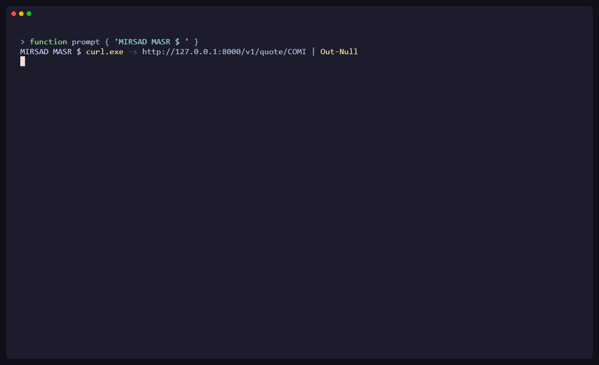

<p align="center">
  
</p>

<p align="center">
  <a href="LICENSE"></a>
  <a href="https://www.python.org/downloads/"></a>
  
</p>

# MIRSAD MASR

Keep Your Eye on Egypt's Markets. Self-hostable FastAPI service for Egyptian Exchange (EGX)
market data. MIRSAD MASR ships a broad EGX symbol catalog and a consistent REST API over
user-configured data providers.

<p align="center">
  
</p>

## Why MIRSAD MASR

Egyptian Exchange data is fragmented. Different providers cover different symbols, return them
in incompatible formats (`COMI`, `COMI.CA`, `CIB.EGX`), and there is no clean Python-friendly
interface that fails over when a source is unavailable. MIRSAD MASR unifies the symbol catalog and
normalizes responses across multiple providers behind one REST API you can run yourself.

> **Legal note:** MIRSAD MASR is software, not a market-data license. Provider terms, rate limits,
> permitted use, and redistribution rules remain the operator's responsibility. Yahoo
> Finance/yfinance support is disabled by default in `.env.example` because it uses
> unofficial Yahoo access.

## Quickstart

```bash
cp .env.example .env
$EDITOR .env                              # add your Alpha Vantage and/or Finnhub key
docker compose up --build

# In another terminal:
curl http://localhost:8000/v1/quote/COMI
```

The API runs at `http://localhost:8000`. Interactive docs are at `http://localhost:8000/docs`.
Build a local image with `docker compose up --build`, or set `MIRSAD_MASR_IMAGE` to your own registry tag.

### API docs (Scalar)

```bash
uv sync --extra dev
uv run uvicorn egxdesk.main:app --reload --host 0.0.0.0 --port 8000
```

- **Interactive reference:** [http://localhost:8000/docs](http://localhost:8000/docs) (Scalar, branded MIRSAD MASR)
- **OpenAPI schema:** [http://localhost:8000/openapi.json](http://localhost:8000/openapi.json)

Default Try-it client is Python `requests` (curl and JavaScript `fetch` are featured). The Scalar
bundle is served from `/static/scalar/` so `/docs` works offline once the app is running.

### API docs (local)

```bash
# with the project venv active:
uvicorn egxdesk.main:app --host 127.0.0.1 --port 8000
```

| URL | What |
|---|---|
| [`http://127.0.0.1:8000/docs`](http://127.0.0.1:8000/docs) | Branded Scalar API reference (Try it: Python `requests` by default) |
| [`http://127.0.0.1:8000/openapi.json`](http://127.0.0.1:8000/openapi.json) | OpenAPI 3 schema |

Default Swagger UI / ReDoc routes are disabled; use `/docs` only.

<details>
<summary><b>Example response</b></summary>

```bash
$ curl http://localhost:8000/v1/quote/COMI
```

```json
{
  "symbol": "COMI",
  "company": "Commercial International Bank Egypt (CIB) S.A.E.",
  "price": 136.0,
  "change": null,
  "change_percent": null,
  "volume": 3579806,
  "high": 136.49,
  "low": 132.5,
  "currency": "EGP",
  "source": "Yahoo Finance (COMI.CA)",
  "api_symbol": "COMI.CA",
  "fetch_duration": 1.212,
  "timestamp": "2026-05-25T23:16:07.747635",
  "attribution": {
    "provider": "Yahoo Finance",
    "url": "https://finance.yahoo.com"
  }
}
```

</details>

## API

| Method | Path | Description |
|---|---|---|
| `GET` | `/v1/health` | Service health and configured providers |
| `GET` | `/v1/stocks` | EGX symbol catalog |
| `GET` | `/v1/quote/{symbol}` | One live quote |
| `GET` | `/v1/quotes` | All currently retrievable quotes |
| `GET` | `/v1/quotes/batch?symbols=COMI,ETEL` | Batch quote lookup |
| `GET` | `/v1/quote/by-company/{name}` | Quote lookup by company-name fragment |
| `GET` | `/v1/status` | Provider, cache, and request counters |
| `GET` | `/demo/quote/{symbol}` | Optional demo endpoint with global daily limit |

## Why not just use yfinance directly?

Yahoo doesn't cover all EGX symbols, symbol formats vary by provider, and there's no fallback
when one source fails or rate-limits you. MIRSAD MASR unifies the symbol catalog, normalizes
responses, and falls back across providers automatically — so a request for `COMI` resolves
the same way whether the underlying answer comes from Alpha Vantage, Finnhub, or Yahoo.

## Data Providers

- **Alpha Vantage** and **Finnhub** require the operator's own API keys (both have free tiers).
- **Yahoo Finance** via `yfinance` is an optional, unofficial provider. Enable it only if your
  use complies with Yahoo and yfinance terms.
- Startup quote warmup and scheduled refresh are configurable via `.env`.
- Responses include provider attribution in the response body and the `X-Data-Source` header.

## Environment Variables

| Variable | Default | Description |
|---|---|---|
| `ALPHA_VANTAGE_KEY` | empty | Alpha Vantage key — provider skipped if empty |
| `FINNHUB_KEY` | empty | Finnhub key — provider skipped if empty |
| `ENABLE_YAHOO_FINANCE` | `false` | Enable unofficial Yahoo Finance/yfinance fetching |
| `CACHE_TTL_SECONDS` | `300` | Quote cache TTL and auto-refresh interval |
| `FETCH_QUOTES_ON_STARTUP` | `true` | Fetch all quotes when the app starts |
| `AUTO_REFRESH_QUOTES` | `true` | Force-refresh all quotes every cache TTL |
| `CACHE_MAX_SIZE` | `512` | Maximum cache entries |
| `LOG_LEVEL` | `info` | `debug`, `info`, `warning`, `error` |

## Contributing

Contributions are welcome — see [CONTRIBUTING.md](CONTRIBUTING.md). Good first issues:

- Adding new EGX symbols to the catalog
- Additional provider adapters (Mubasher, Investing.com scraping with their ToS in mind, etc.)
- Expanding test coverage
- Documentation improvements and translations

## License & Disclaimer

MIT — see [LICENSE](LICENSE). MIRSAD MASR is provided as-is, with no warranty, and is not financial,
investment, legal, or tax advice. Data accuracy and availability depend on third-party
providers. See [DISCLAIMER.md](DISCLAIMER.md).
